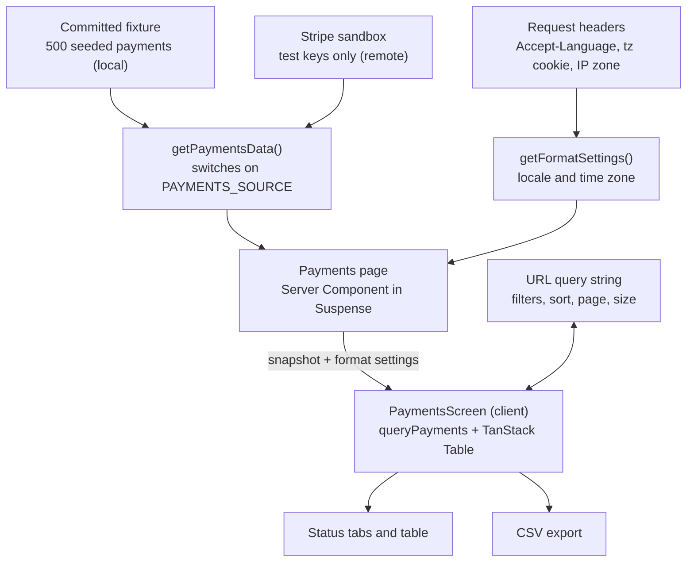

# Chargeblast Payments: Project Presentation

A rebuild of the Stripe Dashboard Payments screen in Next.js 16 and TypeScript. It covers every required feature and all six nice-to-haves, is deployed at [chargeblast-challenge.vercel.app](https://chargeblast-challenge.vercel.app/payments), and the code is on [GitHub](https://github.com/gabrielreisn/chargeblast-challenge).

- [Brief coverage](#brief-coverage)
- [UI choices: a middle ground between the brief and today's Stripe](#ui-choices-a-middle-ground-between-the-brief-and-todays-stripe)
- [Stack](#stack)
- [Architecture](#architecture)
- [UI/UX choices](#uiux-choices)
- [Custom implementations](#custom-implementations)
- [Quality and CI/CD](#quality-and-cicd)
- [Beyond the brief](#beyond-the-brief)

## Brief coverage

Every required item and all six nice-to-haves from the [brief](project-brief.pdf) are built and working in production.

| Brief item                                          | Type           | How it is delivered                                                                                                  |
| --------------------------------------------------- | -------------- | -------------------------------------------------------------------------------------------------------------------- |
| Payment ID, shortened, copy to clipboard            | Required       | Middle-truncated ID (`pi_3abc…wxyz`) with a copy button, "Copied" feedback and an error toast if the clipboard fails |
| Customer                                            | Required       | Email, falling back to name, then "Guest customer"                                                                   |
| Amount with currency                                | Required       | Integer minor units, formatted per currency precision (JPY has no decimals) in the viewer's locale                   |
| Status badge (Succeeded, Pending, Failed, Refunded) | Required       | All four, plus Stripe's other five: Disputed, Uncaptured, Blocked, Incomplete, Canceled                              |
| Payment method: brand and last 4                    | Required       | Card brand marks, wallet icons (Apple Pay, Google Pay), ACH bank icon, last 4                                        |
| Created, with relative time tooltip                 | Required       | Date and time in the viewer's time zone; hover or focus shows "3 hours ago · time zone"                              |
| Sorting on date, amount, status                     | Required       | Header buttons with direction arrows and `aria-sort`                                                                 |
| Pagination 25 / 50 / 100                            | Required       | Rows-per-page select, Previous / Next, "Viewing 1–25 of 500 results"                                                 |
| Date range with presets                             | Required       | Today, Last 7 days, Last 30 days, All time, custom range with validation                                             |
| Status multi-select                                 | Required       | Status filter plus Stripe-style status tabs with counts                                                              |
| Payment method multi-select                         | Required       | Card, ACH, Wallet, Other                                                                                             |
| Amount range                                        | Required       | Min / max with a live input mask and validation                                                                      |
| Search by ID, email or last 4                       | Required       | Top-bar search, `/` shortcut to focus                                                                                |
| Mock data, 300–1,000 rows                           | Required       | 500 deterministic synthetic payments, 5 currencies, 8 statuses, with card details, fees, risk and timelines          |
| Left sidebar with sections                          | Nice-to-have 1 | Full sidebar, collapsible to an icon rail on desktop, drawer on mobile                                               |
| Top bar with search and account menu                | Nice-to-have 2 | Search, docs, notifications, help, account and workspace menus                                                       |
| Payment details page                                | Nice-to-have 3 | `/payments/[id]` with recent activity, payment breakdown, payment method, risk analysis, details and metadata        |
| Filters in the URL                                  | Nice-to-have 4 | Every filter, sort and page lives in the query string; back and forward work                                         |
| Column resizing and drag to reorder                 | Nice-to-have 5 | Drag headings (mouse, touch, keyboard), resize handles, Edit columns panel                                           |
| CSV export of the current view                      | Nice-to-have 6 | Visible columns in table order, selected rows or the whole filtered set                                              |
| Deploy and share on GitHub                          | Delivery       | Vercel production deploy; public repository                                                                          |

## UI choices: a middle ground between the brief and today's Stripe

The brief's reference screenshot shows an older Stripe Dashboard, and the live Stripe Dashboard has since changed. The app keeps the brief's hierarchy where the review compares against it, and takes today's Stripe where the reference is silent or clearly outdated.

| Area              | Brief's reference                                                                                     | Today's Stripe                                                                                        | What the app does                                                                                               |
| ----------------- | ----------------------------------------------------------------------------------------------------- | ----------------------------------------------------------------------------------------------------- | --------------------------------------------------------------------------------------------------------------- |
| Status tabs       | Six bordered cards: All, Succeeded, Refunded, Disputed, Failed, Uncaptured                            | Compact pills: All … Blocked, then a "…" menu                                                         | Today's statuses (seven tabs plus "…" for Incomplete, Canceled, Pending) in the brief's card style, with counts |
| Filters           | Dashed pills: Date and time, Amount, Currency, Status, Payment method, More filters                   | A single Filter button                                                                                | The brief's pills, solid when applied, with removable chips below                                               |
| Transactions tabs | Payments, Payouts, Top-ups, Collected fees, Transfers, All activity                                   | Payments, Payouts, Top-ups, Standalone 3DS, All activity                                              | Today's tabs, each with a Stripe-style empty state                                                              |
| Header actions    | "+ Create payment" (primary) and Analyze                                                              | Export and Analyze icons, "+ Create payment"                                                          | The brief's buttons, read-only with an explanatory tooltip                                                      |
| Sidebar           | Full sidebar with Shortcuts and Products                                                              | Same sections, collapsible to an icon rail                                                            | The brief's sections with today's icons, and today's collapsible rail                                           |
| Table columns     | Amount with inline status, Payment method, Description, Customer, Date, Refunded date, Decline reason | Separate Status column, Wallet, Customer name, Customer email, ID                                     | Required columns (including Payment ID) with a separate Status column; optional columns in Edit columns         |
| Details page      | Not shown                                                                                             | Recent activity, Payment breakdown, Payment method, Risk analysis, Details, Metadata, time conversion | Modeled on today's page, including the time-conversion popover                                                  |

## Stack

The app is a Next.js 16 App Router project in strict TypeScript, styled only with Tailwind utilities, with accessible behaviour delegated to Radix primitives.

| Layer           | Choice                                                                   | Why                                                                                                                 |
| --------------- | ------------------------------------------------------------------------ | ------------------------------------------------------------------------------------------------------------------- |
| Framework       | Next.js 16 (App Router, Cache Components, partial prefetching), React 19 | Server Components for data and metadata, `"use cache"` for the Stripe source, view transitions between routes       |
| Language        | TypeScript 7, strict                                                     | Typed props and option bags for every component; Zod validates data at the boundary                                 |
| Styling         | Tailwind CSS 4, utilities only                                           | Design tokens in `@theme` (colours, font sizes by pixel, breakpoints measured on Stripe); no CSS classes or modules |
| Table           | TanStack Table v9                                                        | Headless: column order, visibility, sizing, resizing and row selection, with our own markup                         |
| Drag and drop   | dnd-kit                                                                  | Column reordering by mouse, touch and keyboard, with screen-reader announcements                                    |
| UI primitives   | Radix (Dialog, Dropdown Menu, Popover, Tooltip, Accordion)               | Focus management, keyboard support and ARIA for menus, popovers and the mobile drawer                               |
| Icons           | lucide-react, plus a hand-drawn Balances glyph in Lucide's style         | Closest match to Stripe's line icons                                                                                |
| Feedback        | sonner                                                                   | Toasts for copy and export results and failures                                                                     |
| Data            | Zod schema, committed JSON fixture, optional Stripe SDK                  | One `Payment` shape whichever source is active                                                                      |
| Tests           | Vitest 5, Testing Library, jsdom, V8 coverage                            | 112 tests, coverage thresholds enforced as a ratchet                                                                |
| Lint and format | oxlint, oxfmt (Oxc)                                                      | Fast Rust tooling; correctness, suspicious and React hooks rules                                                    |
| Dead code       | knip                                                                     | Fails on unused files, exports and dependencies                                                                     |
| Package manager | pnpm 12 with supply-chain settings                                       | Install scripts denied by default, 24-hour minimum release age                                                      |
| Hosting         | Vercel                                                                   | Preview deploy per pull request, production on merge to `main`                                                      |

## Architecture

Pages never import a data source directly: `getPaymentsData()` picks the fixture or Stripe, and the client screen derives everything it shows from the URL.

The server resolves data and the viewer's format settings once per request. Filtering, sorting and pagination then run in the browser over the whole snapshot, so every view change is instant and shareable. The payment details page reads the same snapshot and settings on the server and renders mostly static markup, with small client islands for copying, date popovers and read-only actions.

## UI/UX choices

The guiding rule was to copy Stripe's hierarchy, labels and states, then make every control reachable by keyboard and screen reader.

**Fidelity to Stripe**

- Spacing, font sizes and breakpoints (700 / 1100 / 1600 px) were measured on the real test-mode Dashboard and stored as Tailwind tokens.
- Labels, icons and order follow the reference: status tabs with counts, dashed filter pills with a ⊕ icon that turn solid when applied, Export and Edit columns on the right.
- Status badges use Stripe's colours and trailing icons (✓ succeeded, ✕ failed or canceled, ⊘ blocked, clock for pending states).

**Navigation**

- The sidebar collapses to a 52 px icon rail, as Stripe's does: tooltips replace labels, and shortcuts and products open their pages in flyout menus.
- Below 700 px the sidebar becomes a drawer with focus trapping, opened from a menu button and closed on navigation.
- Destinations the demo does not implement stay visible and focusable, with a "Not available in this demo" tooltip, rather than being links that break.

**The table**

- On desktop the page is one viewport tall: the search bar, tabs and filters stay in view while rows scroll under a sticky header, with a hidden vertical scrollbar.
- Column minimum widths were measured in the browser across 100 rows, so columns shrink to their content and no further.
- Edit columns shows or hides each column (three optional ones start hidden), reorders them, and resets the layout.
- Selecting rows narrows the CSV export to those rows.

**The payment details page**

- Laid out like today's Stripe page: a Transactions breadcrumb, the amount with its status, then Recent activity, Payment breakdown, Payment method and Risk analysis, with Details, Customer and Metadata on the side.
- Recent activity lists the payment's events newest first; failed and blocked payments show the decline reason.
- The breakdown shows the processing fee, refunds and a signed net amount; payments that never captured funds say so instead.
- Payment method expands to type, fingerprint, expiry, issuer, origin country with its flag, CVC check and owner; ACH payments show the bank.
- Risk analysis shows Radar's level and a 0–99 score meter.
- Every date has Stripe's time-conversion popover: the same moment in the viewer's time zone and in UTC.

**Empty, loading and error states**

- A status with no payments shows Stripe's inline empty panel ("No uncaptured test payments") with Clear all; a search with no results shows its own empty state.
- Suspense fallbacks show loading states; route error boundaries keep the tabs usable when data fails to load.
- User-action failures (copy, export) show a plain-language toast, never a raw server message.

**Accessibility**

- Tabs use `aria-pressed`, sortable headers `aria-sort`, and the result count is announced through an `output` region.
- Column drag and drop has keyboard handles and spoken announcements; resizing works with arrow keys.
- Focus rings are visible everywhere, and animations respect reduced motion.

## Custom implementations

Six pieces were written by hand rather than taken from a library, each to keep the demo realistic, reproducible or safe.

**Deterministic data seed generator** (`scripts/generate-payments.ts`)

- Generates 500 fictional payments with seeded random generators, so the same date always produces a byte-identical fixture and diffs stay clean.
- Weighted mixes of currencies (USD, EUR, GBP, BRL, JPY), statuses and methods (cards, Apple Pay, Google Pay, ACH); customers use `example.com` addresses only.
- Each payment carries what the details page needs: card funding, expiry, fingerprint, country, CVC check and issuer; Stripe's processing fee per currency (2.9% + fixed, 0.8% capped for ACH); payout dates; Radar risk; decline reasons; refund and dispute dates; metadata; and an event timeline.
- Details come from a second seeded generator, so adding them never shifted existing IDs, amounts or dates.
- Runs directly in Node with type stripping and validates its output against the app's Zod schema before writing. Uncaptured is left empty on purpose to exercise the empty state.

**Optional live Stripe source** (`PAYMENTS_SOURCE=remote`)

- One switch, `getPaymentsData()`, chooses the committed fixture or the Stripe sandbox; pages never import either directly.
- Reads PaymentIntents plus legacy Charges, up to 1,000 newest first, server-side only and cached with `"use cache"` for about a minute. The balance transaction is expanded for fees and payout dates.
- Accepts only `sk_test_` / `rk_test_` keys and rejects any live-mode object; the key is never a cached argument or a public variable.
- `normalize.ts` maps Stripe's objects to Stripe's dashboard statuses (disputes outrank refunds, Radar blocks become Blocked, `requires_capture` becomes Uncaptured) and fills the same detail fields as the fixture: card checks, risk, statement descriptor, decline messages, metadata and a dated timeline.

**Locale and time zone from the viewer**

- The server reads the locale from `Accept-Language` and the time zone from, in order: a `tz` cookie, Vercel's `x-vercel-ip-timezone`, Cloudflare's `cf-timezone`, then UTC.
- A small client component stores the browser's real time zone in that cookie and refreshes once if the server guessed differently, so IP guesses (VPNs, travel) get corrected.
- Date filters ("Today", "Last 7 days") use the viewer's calendar days, and the footer names the zone ("Dates in Brasilia Standard Time (GMT-3)").

**Formatting, input masks and time conversion**

- One cached set of `Intl` formatters per locale and time zone handles amounts, numbers, dates, relative time, zone names, offsets, card expiry and country names; server and browser render identical markup.
- Amount filter inputs group digits as you type in the viewer's style (`1,234,567.89` or `1.234.567,89`), keep the caret in place, follow the currency's precision and cap at 9 integer digits; the URL keeps the plain number.
- The time-conversion popover renders the same timestamp through the viewer's formatters and a UTC set, labelled with the zone's offset (`-03`, `+05:30`).
- Filtering, sorting and CSV stay locale-independent: integer minor units, ISO dates, raw status codes.

**URL as the source of truth**

- Search, filters, sort, page and page size are parsed from and written to the query string through one module (`url-state.ts`), so any view can be shared and the back button works.
- Every URL value is validated; malformed or hostile input falls back to defaults.

**CSV export**

- Exports the visible columns in their current order, and the selected rows when there are any, otherwise every payment matching the filters.
- Fields are quoted, formula prefixes (`=`, `+`, `@`, `-`) are neutralised, and a byte-order mark makes Excel read UTF-8.

## Quality and CI/CD

Every pull request runs seven GitHub Actions jobs plus a Vercel preview deploy, and no pull request has been merged to `main` before all of them pass.

| Job               | What it runs                                                       | Fails when                                                             |
| ----------------- | ------------------------------------------------------------------ | ---------------------------------------------------------------------- |
| Lint and format   | `pnpm lint` (oxlint, warnings denied), `pnpm format:check` (oxfmt) | Any lint finding or unformatted file                                   |
| Typecheck         | `next typegen` then `tsc --noEmit`                                 | Any type error, including typed route props                            |
| Unit tests        | `pnpm test:coverage` (Vitest, 112 tests)                           | A failing test or coverage below the thresholds in `vitest.config.mts` |
| Unused code       | `pnpm knip`                                                        | An unused file, export or dependency                                   |
| Dependency audit  | `pnpm audit --audit-level high`                                    | A high or critical advisory without a reviewed exception               |
| Dependency review | GitHub's dependency-review action (pull requests)                  | A pull request adds a vulnerable dependency                            |
| Secret scan       | gitleaks                                                           | A credential appears in the history                                    |
| Vercel            | Preview deploy per pull request, production on merge               | The Next.js build fails                                                |

**Locally, before every commit**, a lefthook pre-commit hook runs a gitleaks scan of the staged diff, then `oxlint --fix` and `oxfmt` on staged files, restaging the fixes.

**Supply chain**

- GitHub Actions are pinned to full commit SHAs, with Dependabot keeping them current; shared setup lives in one composite action.
- pnpm denies dependency install scripts by default and refuses versions published less than 24 hours ago, verifying the lockfile against that rule.
- Audit exceptions live in `pnpm-workspace.yaml`, each with a comment saying why it is safe and when to remove it.

**Coverage is a ratchet**: thresholds sit just below current coverage and only move up. Tests sit next to the code and cover query combinations, time zone boundaries, currency precision, status and detail mapping from Stripe, input masks, CSV escaping, the details page and its time conversion, the sidebar rail and drawer, and clipboard failures.

## Beyond the brief

The brief asked for the payments table; everything below went past it.

| Extra                                 | What it adds                                                                                                                                                       |
| ------------------------------------- | ------------------------------------------------------------------------------------------------------------------------------------------------------------------ |
| All nine Stripe statuses              | Disputed, Uncaptured, Blocked, Incomplete and Canceled on top of the four required, with Stripe's tab row, a "…" menu, per-status badges and an inline empty state |
| Live Stripe sandbox source            | The same screen over real sandbox PaymentIntents and Charges, switched with one environment variable, sandbox keys only                                            |
| Rich payment details                  | Recent activity timeline, fee and net breakdown, card or bank details, Radar risk, statement descriptor, payout date, metadata, decline reasons                    |
| Time-conversion popover               | Every date on the details page shows the same moment in the viewer's time zone and in UTC, as Stripe does                                                          |
| Detailed deterministic fixture        | Card details, fees, payout dates, risk, metadata and timelines generated from fixed seeds and validated against the schema                                         |
| Viewer locale and time zone           | Formatting from `Accept-Language`; time zone from the browser, IP headers (Vercel, Cloudflare) or UTC, corrected once by the browser                               |
| Masked amount inputs                  | Locale-aware digit grouping, currency precision and a 9-digit cap while typing                                                                                     |
| Collapsible sidebar and mobile drawer | Icon rail with tooltips and flyout menus on desktop; focus-trapped drawer on phones                                                                                |
| Edit columns panel                    | Show, hide, reorder and reset columns; three optional columns (Refunded amount, Customer name, Intent status)                                                      |
| Measured column widths                | Minimum widths measured in the browser so columns shrink to their content                                                                                          |
| Fixed-height table                    | Filters and search stay visible while rows scroll under a sticky header                                                                                            |
| Row selection                         | Selected rows drive the CSV export and the footer count                                                                                                            |
| Other Transactions tabs               | Payouts, Top-ups, Standalone 3DS and All activity routes with Stripe-style empty states                                                                            |
| SEO and sharing                       | Per-page canonical URLs, Open Graph image, sitemap, robots and web manifest from one module; payment pages are noindex                                             |
| Route transitions                     | View transitions between tabs and pages, disabled for filter changes and reduced motion                                                                            |
| Error handling                        | Route error boundaries and plain-language toasts for failed user actions                                                                                           |
| Accessibility                         | Keyboard column reordering and resizing, screen-reader announcements, `aria-sort`, `aria-pressed`, visible focus, reduced motion                                   |
| Engineering guardrails                | Seven CI jobs, pre-commit secret scan, SHA-pinned actions, supply-chain rules and a coverage ratchet                                                               |
